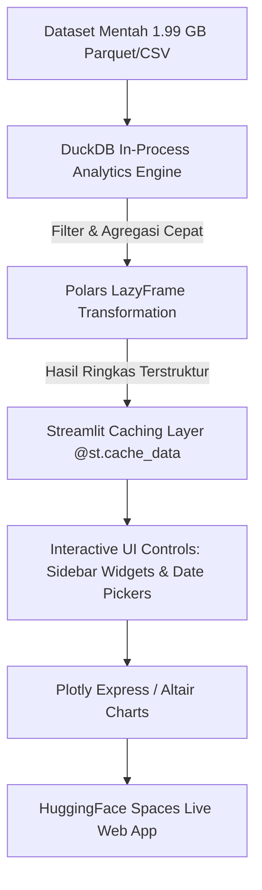

# Dokumen Arsitektur & Pitch Proposal Produk Data (Phase 1)

**Mata Kuliah:** Analisis Big Data  
**Target Check-in:** Pertemuan 10 (Diumumkan Pertemuan 8, repositori dibagikan Pertemuan 9)  
**Nama Tim:** Reva Trisdianto (202310370311323) & Nabila Aurellya Putri (202310370311303)
**Topik / Judul Produk Data:** Dashboard Analitik Tren Pemberitaan & Media Massa Nasional Indonesia  

---

## 1. Problem Statement & Sasaran Pengguna (The Pitch)

### 1.1 Latar Belakang Masalah
Volume pemberitaan digital di media massa nasional Indonesia tumbuh sangat masif setiap harinya dengan jutaan artikel yang tersebar di berbagai portal berita daring. Pembacaan secara manual tidak memungkinkan untuk memetakan pergeseran isu publik, membandingkan intensitas liputan antar-portal media, maupun mendeteksi lonjakan pemberitaan ekstrem (*breaking news spikes*) pada periode tertentu. Oleh karena itu, diperlukan produk data interaktif yang mampu mengolah dataset berita berskala besar (1,99 GB) secara cepat sehingga pola informasi dan dinamika media dapat dieksplorasi secara visual dan terukur.

### 1.2 Target Pengguna (Target Audience)
- **Analis Media & Humas (PR Specialist):** Memantau eksposur pemberitaan lintas portal media (`source`) dan mengukur tren volume publikasi harian maupun bulanan.
- **Peneliti Sosial & Kebijakan Publik:** Mengidentifikasi lonjakan topik atau siklus perhatian publik terhadap isu nasional tertentu berdasarkan lini masa pemberitaan.
- **Jurnalis & Editor Media:** Mengevaluasi karakteristik panjang artikel, pola waktu publikasi, serta perbandingan fokus rubrik antar-media.

### 1.3 Nilai Tambah & Wawasan Utama
- **Pemetaan Siklus Pemberitaan:** Mengidentifikasi jam dan hari puncak publikasi berita serta tren pergerakan volume artikel dari waktu ke waktu (*moving average*).
- **Komparasi Antar-Sumber Media:** Membandingkan produktivitas publikasi, distribusi panjang konten, dan fokus kanal (ekstraksi subdomain `url`) antar-portal berita (`source`).
- **Deteksi Lonjakan Anomali:** Menemukan tanggal-tanggal dengan volume pemberitaan di luar kewajaran (*outlier*) sebagai indikator terjadinya peristiwa besar nasional.

---

## 2. Sumber Dataset & Skala Data

| Parameter | Keterangan |
|-----------|------------|
| **Nama Dataset** | Indonesian News Datasets (`iqballx/indonesian_news_datasets`) |
| **Sumber Resmi** | https://huggingface.co/datasets/iqballx/indonesian_news_datasets/blob/main/data.csv |
| **Format Awal** | CSV (`data.csv`) |
| **Ukuran Data** | 1,99 GB (memenuhi syarat skala besar >500 MB) |
| **Dimensi Waktu / Temporal** | Multi-tahun (mencakup data historis publikasi berita hingga Maret 2023 dengan stempel waktu presisi per detik pada kolom `date`, `created_at`, dan `updated_at`) |
| **Fitur / Kolom Kunci** | `id` (int64), `source` (portal media), `title` (judul berita), `image` (URL gambar), `url` (tautan artikel & indikator rubrik), `content` (isi artikel), `date` (waktu publikasi), `summary` (ringkasan), `created_at`, `updated_at` |

---

## 3. Diagram Arsitektur Data & Aliran Informasi

Gambarkan alur bagaimana data mengalir dari disk mentah hingga ke antarmuka pengguna:

---

## 4. Rencana Pemrosesan Data & Strategi Caching

### 4.1 Peran DuckDB (SQL Engine)
- **Pembacaan & Konversi CSV ke Parquet:** DuckDB membaca file mentah `data.csv` (1,99 GB) secara langsung menggunakan `read_csv_auto()` dan melakukan proyeksi kolom untuk mengecualikan kolom vektor `embedding` yang berukuran sangat besar, lalu mengekspornya menjadi file Parquet terkompresi agar pembacaan berikutnya jauh lebih ringan dan cepat.
- **Operasi Analitik Berat:** Mendelegasikan kalkulasi statistik deskriptif (`SUMMARIZE`), agregasi jumlah artikel berdasarkan `source` dan rentang tanggal, perhitungan panjang karakter/kata artikel, serta *window function* (`LAG` dan *running total*) langsung di dalam mesin SQL DuckDB sebelum dikirim ke lapisan Python.

### 4.2 Peran Polars (Transformasi Data)
- **Ekstraksi Fitur & Pembersihan:** Menggunakan `Polars LazyFrame` untuk mengekstrak nama rubrik/kanal berita dari struktur `url` (misalnya `nasional.tempo.co`), melakukan standarisasi format *timestamp* pada kolom `date`, menghitung jumlah kata (`word_count`), serta membersihkan baris duplikat atau kosong.
- **Transformasi Deret Waktu:** Menghitung fitur *moving average* (rata-rata bergerak 7 harian dan 30 harian) serta perubahan persentase volume berita harian secara *multithreaded* dan hemat memori.

### 4.3 Strategi Optimasi Memori & Caching Streamlit
- **Caching Kueri & Koneksi:** Menggunakan dekorator `@st.cache_resource` untuk mempertahankan koneksi DuckDB dan `@st.cache_data` pada setiap fungsi kueri agregasi berbasis parameter filter (portal media, rentang tanggal, kata kunci), sehingga perubahan filter di UI tidak memicu pemindaian ulang file mentah.
- **Manajemen Batas RAM 16 GB HuggingFace Spaces:** Tidak pernah memuat seluruh file mentah `data.csv` (1,99 GB) maupun kolom `embedding` ke dalam memori Pandas atau `st.session_state`. Data dikonversi terlebih dahulu menjadi file Parquet bersih tanpa kolom `embedding` dan `image` pada tahap *pipeline*, sehingga Streamlit hanya memproses tabel hasil agregasi berukuran kecil untuk dirender oleh Plotly.

---

## 5. Rencana Tampilan Dashboard (Wireframe & Fitur UI)

1. **Header & Key Metrics KPI:**
   - 4 Kartu metrik ringkasan: Total Artikel Teranalisis, Jumlah Portal Media (`source`), Rata-rata Panjang Kata per Artikel, serta Puncak Publikasi Harian Tertinggi beserta tren persentasenya.
2. **Filter Interaktif (Sidebar):**
   - Multiselect pemilihan portal media (`source`), slider rentang tanggal publikasi (`date`), filter kanal/rubrik hasil ekstraksi URL, dan kotak pencarian kata kunci judul.
3. **Panel Visualisasi Utama:**
   - **Tab 1 — Tren Temporal:** *Line chart* interaktif volume publikasi berita harian/bulanan dilengkapi *range slider* dan garis *moving average* 7-hari.
   - **Tab 2 — Analisis Distribusi & Anomali:** *Box plot* distribusi panjang artikel per portal media serta deteksi lonjakan volume berita harian (*outlier* peristiwa ekstrem).
   - **Tab 3 — Komparasi Portal & Kanal Berita:** *Bar chart* peringkat produktivitas portal media, proporsi kanal/rubrik berita, dan analisis jam publikasi tersibuk (*heatmap* hari vs jam).
   - **Tab 4 — Tabel Data Detail:** Cuplikan daftar judul, portal media, tanggal, dan ringkasan artikel terfilter (maksimal 100 baris pratinjau) dilengkapi tombol unduh ringkasan CSV.

---

## 6. Pembagian Tugas & Tanggung Jawab Anggota Tim

| Anggota Tim | Tanggung Jawab Utama di Phase 1 - 4 |
|-------------|-------------------------------------|
| Reva Trisdianto | Lead Architect, desain *data pipeline* (Polars & konversi CSV ke Parquet), integrasi `Dockerfile`, serta manajemen repositori & *deployment* ke HuggingFace Spaces |
| Nabila Aurellya Putri | Penyusunan kueri analitik SQL DuckDB, optimasi *caching* (`@st.cache_data`), desain antarmuka Streamlit, serta pengembangan visualisasi interaktif Plotly |